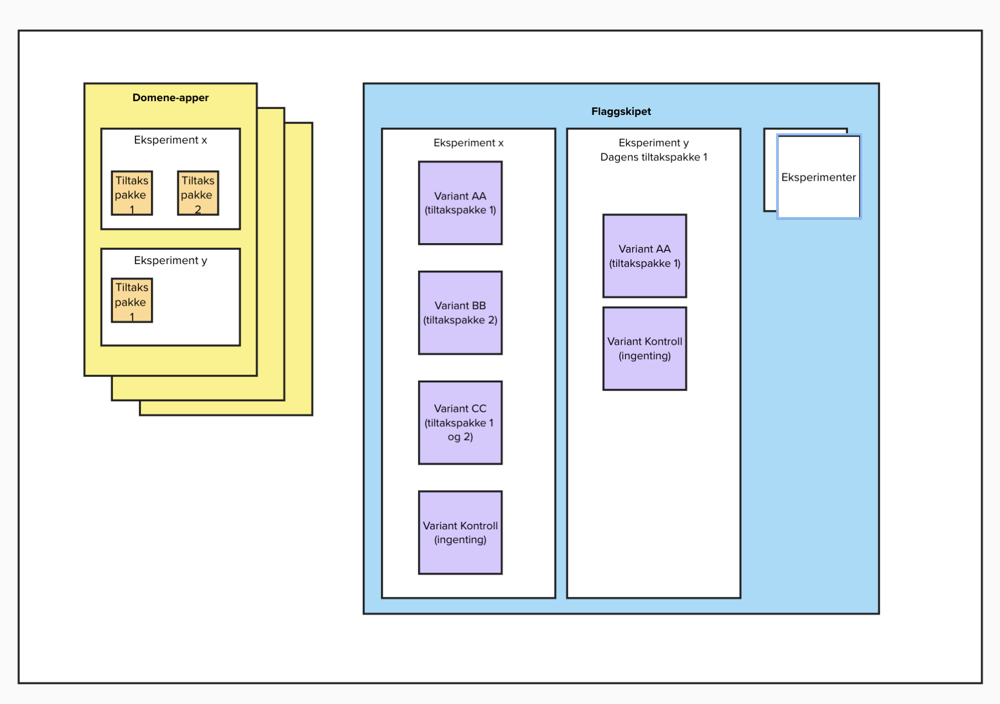

# ADR-0001: Skille eksperimenter fra tiltakspakker

**Dato:** 2026-10-12
**Status:** Foreslått
**Beslutningstakere:** Team eSyfo

## Kontekst

Flaggskipet skal støtte eksperimenttildeling for flere typer tiltakspakker.
Vi skiller mellom brukerrettet funksjonalitet i domeneappene og eksperimenter
med varianter i Flaggskipet. Vanlige driftstoggles for av/på-styring, gradvis
utrulling og nødstopp er utenfor scope for denne ADR-en.

I dagens kode samler `Tiltakspakke` en ID, en sluttdato og en vurderingsregel.
`Regel` returnerer `TILTAKSGRUPPE`, `KONTROLLGRUPPE` eller `UTENFOR_SCOPE`.
Pakkelisten inneholder bare `OPPFOLGINGSPLAN_TILTAKSPAKKE_1`, og vurderingsflyten
og det lagrede grunnlaget er knyttet til adresse og fylke.

Dagens modell skiller ikke mellom eksperimentet og varianten en deltaker tilhører. Skissen viser behovet for
eksperimenter med flere varianter, der en variant også kan kombinere tiltakspakker.

## Beslutning

Vi foreslår følgende ansvarsdeling og retningslinjer. Dette beskriver ønsket
retning, ikke funksjonalitet som allerede er implementert.

- **Domeneappene har ansvar for tiltakspakkene.** De implementerer funksjonaliteten
  og eier koblingen fra variant-ID til tiltakspakkene som brukeren møter.
- **Flaggskipet har ansvar for eksperimenter, varianter og fordeling.** Et
  eksperiment samler variantene som sammenlignes. Fordelingen avgjør hvilken
  variant en deltaker tilhører. Flaggskipet returnerer eksperiment- og variant-ID,
  ikke hvilke tiltakspakker domeneappene skal aktivere.
- **Variant og tiltakspakke er ulike begreper.** En variant kan aktivere én
  tiltakspakke, en kombinasjon av tiltakspakker eller ingen av tiltakspakkene
  som prøves ut. Flere tiltakspakker i én variant er ikke separate eksperimenter.
- **Kontroll er en egen variant innenfor et eksperiment.** Kontrollvarianten
  aktiverer ingen tiltakspakker gjennom dette eksperimentet. Deltakeren kan
  likevel motta behandling gjennom andre eksperimenter. Vanlig funksjonalitet
  fjernes ikke.
- **Kontroll må skilles fra å være utenfor eksperimentet.** `UTENFOR_SCOPE`,
  manglende vurdering og feil skal ikke tolkes som tildeling til kontrollvarianten.
- **En ukjent variant er et eksplisitt feilutfall.** Domeneappen beholder den
  vanlige brukerreisen uten å aktivere ukjent eksperimentfunksjonalitet og
  registrerer feilutfallet med varsling til driften. Den opprinnelige tildelingen
  beholdes; uteblitt behandling skal ikke telles som en kontrolltildeling i analysen.
- **Eksperimenter og varianter er uforanderlige etter oppstart.** Målgruppe,
  variantsett, fordelingsregler og den avtalte betydningen av hver variant fryses
  når eksperimentet starter. Domeneappene skal ikke endre hvilke tiltakspakker
  en variant omfatter underveis.
- **Endret forsøksoppsett krever et nytt eksperiment med ny ID.** Det eksisterende
  eksperimentet og variantene beholder sin opprinnelige betydning. Tidligere
  tildelinger bevares og skal ikke overskrives eller beregnes på nytt som del
  av endringen.
- **Aktive eksperimenter defineres i en liste i koden.** Listen

  bestemmer hvilke eksperimenter som er gjeldende. Når et eksperiment tas ut av
  listen, skal en historisk tildeling ikke i seg selv aktivere tiltakspakker fra
  eksperimentet. Tildelingen bevares som historikk og omskrives ikke til kontroll.
  Endringer i listen styrer livsløpet, ikke betydningen av eksperimentet eller
  variantene.
- **Overlapp mellom eksperimenter tillates.** Flaggskipet har ingen generell
  sperre mot deltakelse i flere samtidige eksperimenter. Samspillet håndteres
  i forsøksdesign og analyse og må være avklart før oppstart.

Se [begrepslisten](../../CONTEXT.md) for definisjonene.

### Rammer før oppstart

Et eksperiment må ha en avklart forsøksplan før det starter. Eksperimenteieren
har ansvar for å avklare planen med relevante domene- og analyseansvarlige.
Planen skal beskrive:

- Formål, funksjonaliteten som prøves ut og effektmål.
- Målgruppe, scope-kriterier og hvilke underenheter som kan delta.
- Varianter, fordeling og koblingen fra variant-ID til tiltakspakker i domeneappene.
- Forholdet til samtidige eksperimenter, inkludert felles tiltakspakker eller
  påvirkning på samme funksjonalitet, brukerreise eller effektmål.
- Hvordan påvirkning fra andre eksperimenter håndteres i forsøksdesign og analyse.
  En kontrollvariant må ikke behandles som en gruppe uten tiltak dersom deltakerne
  kan få de samme tiltakene gjennom et annet eksperiment.

Flaggskipet kjenner ikke domeneappenes kobling til tiltakspakker og kan derfor
ikke alene oppdage slike påvirkninger. Dersom samspill mellom eksperimenter
inngår i forsøket, må planen beskrive hvordan resultatene skal tolkes.

### Skissen som diagram

Diagrammet viser struktur og ansvarsdeling.

## Alternativer vurdert i dette forslaget

### A: Eksperimenter og varianter i Flaggskipet (foreslått)

Domeneappene implementerer tiltakspakkene, mens Flaggskipet fordeler deltakere
til varianter. Dette gir et felles sted for tildeling og gjør kombinasjoner av
tiltakspakker uttrykkelige. Det krever en avklart kontrakt og at domeneappene
tolker variantene likt.

### B: Eksperimenter og fordeling i hver domeneapp

Domeneappene styrer både funksjonalitet og tildeling. Det gir lokal kontroll,
men kan duplisere fordelingslogikk og gjøre det vanskeligere å samordne
eksperimenter og analysegrunnlag.

### C: Beholde dagens modell

Vi fortsetter å knytte hver tiltakspakke til en regel og de tre
deltakelsesutfallene. Det krever ingen endring nå, men gjør skillet mellom
eksperiment, variant og brukerrettet funksjonalitet uklart. Kombinasjoner og
flere varianter må da håndteres uten en eksplisitt modell for dem.
